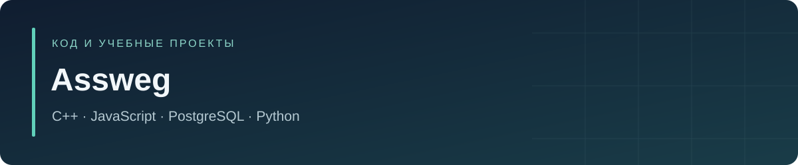

# Привет, я Assweg

Студент-разработчик. В профиле — лабораторные, практические и курсовые проекты: от структур данных на C++ до веб-приложений и безопасности PostgreSQL.

**[Открыть учебный архив НГТУ →](https://github.com/Assweg/nstu)**

В архиве собраны исходники, отчёты и данные со 2-го по 7-й семестр. У отдельных проектов есть собственные репозитории с описанием состава и запуска.

## Проекты, с которых можно начать

| Проект | Что можно посмотреть |
|---|---|
| [nstu](https://github.com/Assweg/nstu) | Полный каталог работ, отчёты, Notebook по подготовке данных ИБ |
| [4laba_4sem](https://github.com/Assweg/4laba_4sem) | Мониторинг энергообъектов: React, Express, PostgreSQL |
| [crpted2](https://github.com/Assweg/crpted2) | Учебная платформа по криптографии, авторизация и Docker |
| [laba2_bsbd](https://github.com/Assweg/laba2_bsbd) | Роли, выполнение функций и триггеры PostgreSQL |
| [2prac_3sem](https://github.com/Assweg/2prac_3sem) | Многопоточный сетевой сервер мини-СУБД на C++ |
| [3laba_3sem](https://github.com/Assweg/3laba_3sem) | Тестирование структур данных на C++ и Go |

## Технологии в работах

`C++` `JavaScript` `React` `Node.js / Express` `Python / Flask` `SQL / PLpgSQL` `PostgreSQL` `Go` `Swift` `Docker` `Git`

## Второй семестр

| Репозиторий | Содержание |
|---|---|
| [1laba_2sem](https://github.com/Assweg/1laba_2sem) | Git + геометрия на C++ |
| [2laba_2sem](https://github.com/Assweg/2laba_2sem) | 3 задачи на Swift (+11 языков для сравнения) |
| [3laba_2sem](https://github.com/Assweg/3laba_2sem) | Функции, простые числа и модель охлаждения |
| [7laba_2sem](https://github.com/Assweg/7laba_2sem) | Калькулятор + сортировка цепочек (C++) |
| [RGR_2sem](https://github.com/Assweg/RGR_2sem) | Исходники РГР пока не найдены |

## Третий семестр

| Репозиторий | Содержание |
|---|---|
| [1laba_3sem](https://github.com/Assweg/1laba_3sem) | Структуры данных на C++: список, стек, хеш-таблица |
| [2laba_3sem](https://github.com/Assweg/2laba_3sem) | 6 заданий по структурам данных на C++ |
| [3laba_3sem](https://github.com/Assweg/3laba_3sem) | Тесты структур данных + Makefile |
| [4laba_3sem](https://github.com/Assweg/4laba_3sem) | Потоки, regex-обработка, алгоритм банкира (C++) |
| [5laba_3sem](https://github.com/Assweg/5laba_3sem) | Консольный маркетплейс на C++ |
| [6laba_3sem](https://github.com/Assweg/6laba_3sem) | Исходники шестой лабораторной пока не найдены |
| [1prac_3sem](https://github.com/Assweg/1prac_3sem) | C++ сетевой сервер мини-СУБД (базовый) |
| [2prac_3sem](https://github.com/Assweg/2prac_3sem) | C++ сетевой сервер мини-СУБД (многопоточный) |
| [1laba_3sem_false](https://github.com/Assweg/1laba_3sem_false) | Черновик структур данных (архив) |

## Веб-проекты и базы данных

| Репозиторий | Содержание |
|---|---|
| [1laba_4sem](https://github.com/Assweg/1laba_4sem) | Фронтенд мониторинга на React + Chart.js |
| [4laba_4sem](https://github.com/Assweg/4laba_4sem) | Мониторинг энергообъектов НСО: React + Express |
| [rgr_4sem](https://github.com/Assweg/rgr_4sem) | РГР: защищённый мониторинг на Flask + Security |
| [crpted](https://github.com/Assweg/crpted) | Курсовая: Express + PostgreSQL, авторизация (v1) |
| [crpted2](https://github.com/Assweg/crpted2) | Курсовая: Express + PostgreSQL + Docker (v2) |
| [laba1_bsbd](https://github.com/Assweg/laba1_bsbd) | БД студии дубляжа: PostgreSQL, роли, RLS, Docker |
| [laba2_bsbd](https://github.com/Assweg/laba2_bsbd) | PostgreSQL: журнал функций, SECURITY DEFINER и триггеры |

## Достижения GitHub

[Pull Shark x2 · Quickdraw · Galaxy Brain · YOLO](https://github.com/Assweg?tab=achievements)

## Связь

[Telegram @assweg](https://t.me/assweg) · [GitHub @Assweg](https://github.com/Assweg)
